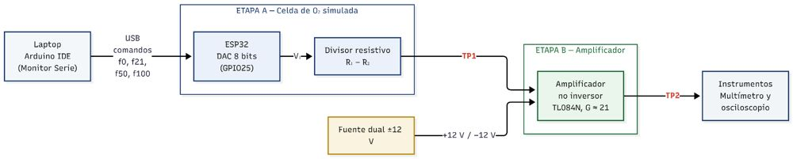
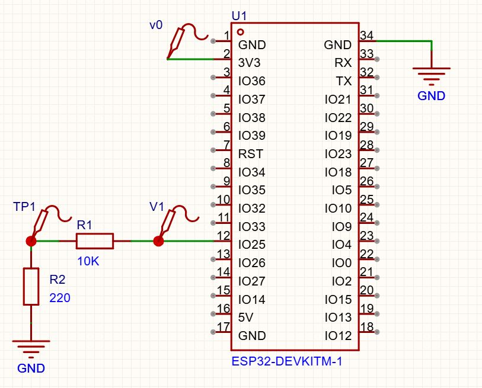
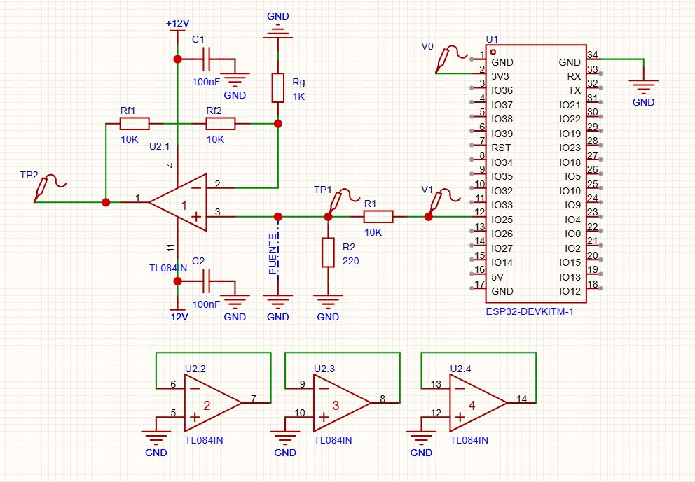
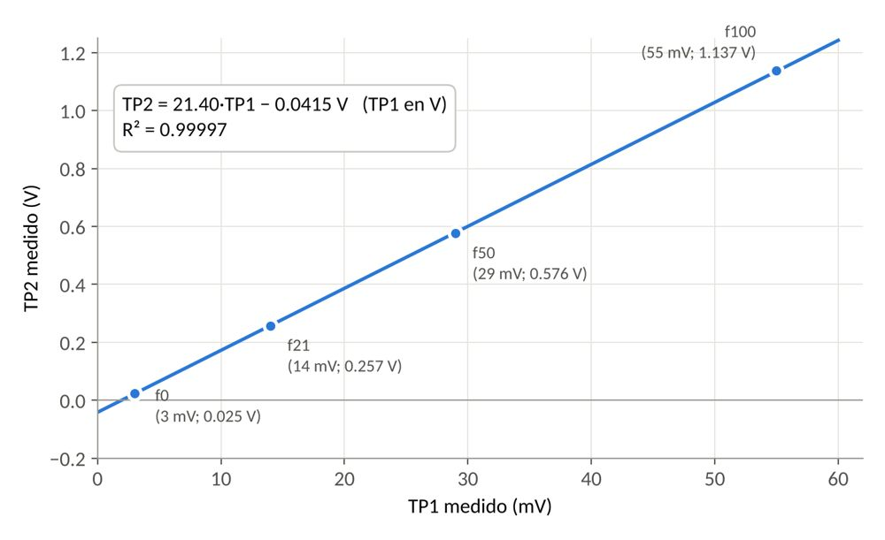

# Canal de medición de oxígeno de una máquina de anestesia: celda de O₂ simulada y amplificador

**Informe de Laboratorio N.º 3 — Taller de Equipos Biomédicos II**
*Escuela Profesional de Ingeniería Biomédica — Universidad Nacional Mayor de San Marcos (UNMSM)*

## 1. Resumen

Se armaron las dos primeras etapas del canal de medición de oxígeno de una máquina de anestesia: una **celda de O₂ simulada** (DAC del ESP32 + divisor resistivo, salida **TP1**) y un **amplificador no inversor** con el **TL084N** (salida **TP2**). Se midieron los niveles de la celda para los comandos `f0`, `f21`, `f50` y `f100`, y se determinaron el offset y la ganancia real del amplificador.

- **Celda simulada:** TP1 resultó de **3, 14, 29 y 55 mV**. Los valores de f21, f50 y f100 quedaron **fuera de los rangos de la guía** porque la resistencia R2 medida fue de **213.8 Ω** (se usó una de 220 Ω en lugar de 180 Ω): relación del divisor **0.02101** frente a 0.01768. Además, el DAC entregó **0.136 V en f0**, no 0 V.
- **Amplificador:** ganancia real **21.46** (0.63 % respecto a la de diseño, 21.33), comportamiento lineal (**R² = 0.99997**) y offset de **−35 mV** en la salida (**−1.63 mV** referido a la entrada), dentro de lo que indica la hoja de datos del TL084.
- **Sin calibrar**, el monitor indicaría **25.7 % de O₂ en aire** y **113.7 % en oxígeno puro**; por eso el equipo debe calibrarse en aire y en oxígeno puro.

---

## 2. Objetivos

**General:** armar la celda de O₂ simulada y su amplificador, que forman las dos primeras etapas del canal de medición de oxígeno de una máquina de anestesia, y comprobar que cada etapa funciona.

**Específicos:**
- Comprobar que TP1 entrega los milivoltios esperados para 0, 21, 50 y 100 % de O₂ y, si algún valor no coincide, determinar si el error proviene del ESP32 o de las resistencias del divisor.
- Medir el offset del amplificador y su ganancia real, y compararlos con los valores de diseño.

---

## 3. Fundamento

**Celda de O₂ simulada.** El DAC de 8 bits del ESP32 entrega en GPIO25 una tensión proporcional al código enviado, donde V₀ es la tensión del pin 3V3. Un divisor resistivo la reduce a TP1:

$$V_1 = \frac{\text{código DAC}}{255}\,V_0 \qquad\qquad TP1 = V_1\,\frac{R_2}{R_1+R_2}$$

Con R₁ = 10 kΩ y R₂ = 180 Ω (diseño), la relación es 0.01768: TP1 entrega 10 mV en aire y 47.6 mV en oxígeno puro, la escala de una celda galvánica real.

**Amplificador no inversor.** La ganancia la fija la red de realimentación, y el offset de entrada Vos del op-amp se multiplica por la misma ganancia:

$$G = 1 + \frac{R_{f1}+R_{f2}}{R_g} \qquad\qquad TP2 = G\,(TP1 + V_{os})$$

Con Rf1 = Rf2 = 10 kΩ y Rg = 1 kΩ, G = 21: TP2 entrega **10 mV por punto porcentual de O₂** (0.21 V en aire, 1.00 V en oxígeno puro).

### Diagrama de bloques

*Figura 1. Laptop → ESP32 (DAC, GPIO25) → divisor resistivo (TP1, Etapa A) → amplificador no inversor (TP2, Etapa B) → multímetro y osciloscopio.*

---

## 4. Esquemáticos y montaje

Esquemático completo en [`Esquematico Etapa A y B.pdf`](Esquematico%20Etapa%20A%20y%20B.pdf).

### Etapa A — Celda de O₂ simulada

| Elemento | Conexión |
| --- | --- |
| R1 | GPIO25 → TP1 |
| R2 | TP1 → GND del ESP32 (tierra común) |

*Figura 2. Esquemático de la Etapa A (EasyEDA).*

### Etapa B — Amplificador (TL084N)

| Elemento | Conexión |
| --- | --- |
| Alimentación | Pin 4 = +12 V · Pin 11 = −12 V · 100 nF de cada uno a GND |
| TP1 | Pin 3 (entrada no inversora del op-amp 1) |
| Rg | Pin 2 → GND |
| Rf1 + Rf2 (en serie) | Pin 2 → Pin 1 |
| TP2 | Pin 1 (salida del op-amp 1) |
| Op-amps 2, 3 y 4 (sin uso) | Salida unida a la entrada inversora; entrada no inversora a GND |
| Medición de offset | Puente entre el pin 3 y GND (se retira luego) |

*Figura 4. Esquemático de la Etapa B (EasyEDA).*

---

## 5. Procedimiento para replicar la experiencia

### Código del ESP32

El programa [`simulador_o2/`](simulador_o2/) se carga desde el Arduino IDE (placa ESP32 Dev Module, Monitor Serie a **115 200 baudios**). Los comandos `f0`, `f21`, `f50` y `f100` fijan el DAC de GPIO25 en los códigos 0, 44, 104 y 208.

### Etapa A

1. Medir las cinco resistencias con el multímetro.
2. Conectar el ESP32 a la laptop por USB y cargar `simulador_o2.ino`.
3. Armar el divisor: R1 entre GPIO25 y TP1; R2 entre TP1 y GND (tierra común).
4. Medir V₀ (3V3 – GND).
5. Enviar `f0`, `f21`, `f50` y `f100` y registrar V1 (GPIO25) y TP1.
6. Comprobar que cada TP1 esté dentro del rango de la guía.

### Etapa B

1. Fuente en modo dual ±12 V con la **salida apagada**; terminal común a GND.
2. Alimentar el TL084N (pin 4 = +12 V, pin 11 = −12 V) con 100 nF de desacople; dejar los op-amps 2, 3 y 4 como seguidores con la entrada a GND.
3. En el op-amp 1: TP1 al pin 3, Rg entre pin 2 y GND, Rf1 y Rf2 en serie entre pin 2 y pin 1 (TP2).
4. **Antes de energizar** colocar el puente pin 3 – GND. Encender y medir los pines 4 y 11 y TP2 (**offset**, con signo). Si TP2 ronda ±10 V, apagar de inmediato y revisar.
5. Retirar el puente, enviar `f0`, `f21`, `f50` y `f100` y registrar TP1 y TP2.
6. Con `f50`, observar TP2 en el osciloscopio: debe ser una línea horizontal estable.

Reproduce las desviaciones, la ganancia, el ajuste lineal y la calibración en dos puntos a partir de [`datos/`](datos/).

---

## 6. Resultados Propios

### Resistencias medidas (Fluke 179)

| Resistencia | Ubicación | Valor medido |
| --- | --- | --- |
| R1 (10 kΩ) | Divisor | 9.96 kΩ |
| R2 (220 Ω) | Divisor | **213.8 Ω** |
| Rg (1 kΩ) | Amplificador | 0.974 kΩ |
| Rf1 (10 kΩ) | Amplificador | 9.82 kΩ |
| Rf2 (10 kΩ) | Amplificador | 9.98 kΩ |

### Etapa A — Celda simulada (V₀ = 3.28 V)

| Comando | Código DAC | V1 medido (V) | TP1 medido (mV) | Rango de la guía (mV) | ¿Dentro? |
| --- | --- | --- | --- | --- | --- |
| f0 | 0 | 0.136 | 3 | — | — |
| f21 | 44 | 0.656 | 14 | 9.0 – 11.0 | No |
| f50 | 104 | 1.367 | 29 | 21.4 – 26.2 | No |
| f100 | 208 | 2.620 | 55 | 42.9 – 52.4 | No |

| Comando | Cociente TP1/V1 |
| --- | --- |
| f21 | 0.02134 |
| f50 | 0.02121 |
| f100 | 0.02099 |

- Relación del divisor con valores medidos: k = 213.8 / (9960 + 213.8) = **0.02101** (diseño: 0.01768). El cociente TP1/V1 coincide con k con diferencias menores a 1.6 %, así que **el error proviene del divisor (R2), no del ESP32**.
- En f0, V1 = 0.136 V (el DAC no llega a 0 V) → 0.136 × 0.02101 = 2.9 mV ≈ **3 mV** medidos en TP1.

### Etapa B — Amplificador

| Medición | Punto | Valor |
| --- | --- | --- |
| Alimentación positiva | Pin 4 | +12.00 V |
| Alimentación negativa | Pin 11 | −12.00 V |
| Offset (entrada a GND) | TP2 | −0.035 V |

| Comando | TP1 (mV) | TP2 (V) |
| --- | --- | --- |
| f0 | 3 | 0.025 |
| f21 | 14 | 0.257 |
| f50 | 29 | 0.576 |
| f100 | 55 | 1.137 |

| Parámetro | Valor |
| --- | --- |
| Ganancia de diseño, 1 + (Rf1 + Rf2)/Rg (resistencias medidas) | 21.3285 |
| Ganancia real, (TP2f100 − TP2f21) / (TP1f100 − TP1f21) | 21.4634 |
| Error de la ganancia real respecto a la de diseño | 0.63 % |
| Offset referido a la salida | −0.035 V |
| Offset referido a la entrada | −1.63 mV |
| Ajuste lineal TP2 = f(TP1) | TP2 = 21.40·TP1 − 0.0415 V, R² = 0.99997 |

*Figura 9. TP2 en función de TP1 con los cuatro niveles y recta de ajuste.*

### Calibración en dos puntos

| Situación | Aire (f21) | Oxígeno puro (f100) | f50 |
| --- | --- | --- | --- |
| Sin calibrar (10 mV/%) | 25.7 % | 113.7 % | 57.6 % |
| Calibrado con aire y O₂ puro | 21.0 % | 100.0 % | 49.6 % |

Sensibilidad real = (1.137 − 0.257)/(100 − 21) = **11.14 mV/%**; cero real = **0.0231 V**.
El oxígeno puro fija la parte alta de la escala (corrige la ganancia, afectada por R2); el aire fija la parte baja (corrige el offset del DAC y del amplificador).

---

## 8. Materiales y equipos

| Componente / equipo | Cantidad | Observación |
| --- | --- | --- |
| ESP32 DevKit V1 (ESP32-WROOM-32) | 1 | Simula la celda con el DAC de GPIO25 |
| Cable USB de datos | 1 | |
| Laptop con Arduino IDE | 1 | Monitor Serie a 115 200 baudios |
| Circuito integrado TL084N | 1 | Op-amp 1 amplificador; 2, 3 y 4 seguidores a GND |
| Resistencia 10 kΩ | 3 | R1, Rf1, Rf2 |
| Resistencia 1 kΩ | 1 | Rg |
| Resistencia 220 Ω | 1 | R2 (en lugar de 180 Ω) |
| Capacitor cerámico 100 nF | 2 | Desacople pines 4 y 11 |
| Protoboard y ≈ 20 jumpers | 1 | |
| Fuente de banco | 1 | Dual ±12 V |
| Multímetro Fluke 179 True RMS | 1 | |
| Osciloscopio Keysight InfiniiVision DSOX1202G | 1 | |

## 9. Integrantes

Sotomayor Villanueva, Genny Solangch       23190393 
Lázaro Canales, Jair Renato                23190377 
Arroyo Ramos, Rosbeth Nayelhy              23190114 
